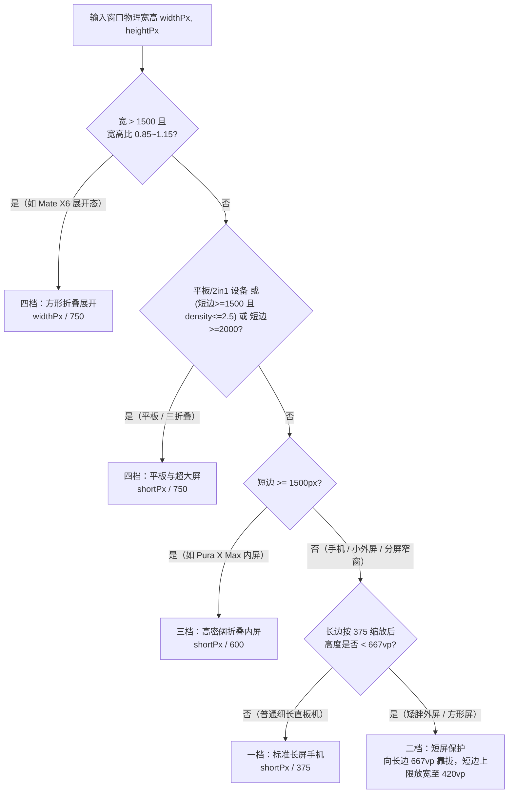

在 HarmonyOS 应用开发中，很多团队会采用「375 / 750 两档设计稿等比缩放」方案：手机端统一按宽度 `375vp` 计算窗口密度（`windowStage.setCustomDensity`），折叠屏展开态与平板统一按 `750vp` 计算。这套方案在 19.5:9 或 20:9 的传统细长直板手机上运行良好，因为宽度锁死 `375vp` 后，纵向仍然有 `800vp` 以上的可视高度。

但当应用运行在 HUAWEI Pura X（16:10 阔折叠，外屏 3.5 英寸 `980×980`）或 HUAWEI Pura X Max（横折阔折叠，外屏 5.4 英寸 `1264×1848`、内屏 7.7 英寸 `2584×1828`）这类「矮胖型」阔折叠设备上时，两档缩放会同时在内外屏暴露出两个问题：外屏被横向放大后纵向空间严重不足，弹窗按钮被顶出屏幕；内屏展开后又因为分辨率跨过阈值被误判为 11 英寸平板，字号瞬间缩小近四分之一。

经过实测与验证，我们的核心结论是：**阔折叠屏幕适配不能只看单边宽度套用 `375 / 750` 两档基准；窄屏端必须引入受长边高度约束的「短屏保护（宽度上限放宽至 `420vp`）」，展开态必须区分「高密阔折叠手机（`600vp` 短边基准）」与「低密平板（`750vp` 基准）」，并且将业务层与 Flutter 容器的像素换算统一收口到窗口生效密度。**

## 为什么「375 / 750 两档缩放」会在阔折叠上失效

把所有屏幕简单切分为 `375vp` 和 `750vp` 两档，隐含了两个在阔折叠设备上不再成立的前提假设。

### 误判一：认为所有窄屏手机只要锁死 375vp 宽度，纵向就一定够用

传统直板机（如 `1080×2400`）的长宽比在 2.16 左右，按 `1080 / 375 = 2.88` 设置密度后，逻辑尺寸是 `375vp × 833vp`，纵向空间非常充裕。

而 Pura X Max 的 5.4 英寸外屏物理分辨率是 `1264×1848`，长宽比只有 `1.46:1`。如果仍然死守 `375vp` 宽度：

- 窗口密度会被拉高到 `1264 / 375 ≈ 3.37`（高于系统默认的 `3.0~3.25`）；
- 所有组件和字号被整体放大约 12%，纵向逻辑高度从系统原本的 `616vp` 被硬生生压扁到 **`548vp`**；
- 扣掉状态栏、导航栏、标题栏和底部 Tab 后，中间内容区只剩约 `380vp`。

到了 Pura X 的 1:1 方形外屏（`980×980`）上，锁死 `375vp` 更是只剩 `375vp × 375vp` 的可视区域。任何写死了固定高度（例如 `height: 450`）的协议弹窗、带大间距的登录页或超过 8 个选项的底部半屏菜单，都会直接溢出屏幕边界。

### 误判二：把「分辨率大于 1500px」等同于「物理尺寸达到 11 英寸平板」

为了兼顾平板竖屏（如 `1600×2560`），不少缩放实现会把「双边物理像素均大于 `1500px`」作为切入 `750vp` 基准的判断条件。

但 Pura X Max 的 7.7 英寸内屏像素密度高达 412 PPI，物理分辨率达到了 `2584×1828`（短边 `1828px > 1500px`）。如果直接落入 `750vp` 分支：

- 横握展开时按短边 `1828 / 750 = 2.44` 计算密度；
- 用户合上手机看外屏时密度是 `3.37`，翻开内屏瞬间跌到 `2.44`，文字和图标物理尺寸骤缩 **27.6%**；
- 如果用户在内屏开启左右 1:1 分屏（单窗 `1280×1828`），宽度掉回 `1500px` 以内，密度又跳回 `1280 / 375 = 3.41`，分屏比全屏字号反而大了一圈。

## 四档自适应缩放规则与短屏保护

要同时解决「小外屏纵向压扁」和「内屏展开字号骤降」，需要将单一的宽度判定升级为「屏幕形态四档分级」：



这四档规则的工程边界与设计取舍如下：

| 档位 | 适用屏幕形态 | 代表设备与场景 | 缩放基准规则 | 设计目的 |
| --- | --- | --- | --- | --- |
| **一档：标准长屏** | 常规直板手机、细长折叠外屏（长宽比 ≥ 16:9） | Mate 60、Pura 70、Mate X6 外屏 | 短边固定按 **375vp** | 与 375 设计稿 1:1 还原，存量直板机视觉零变化 |
| **二档：矮胖短屏** | 阔折叠小外屏、方形外屏、16:10 宽屏、1:1 分屏窄窗 | Pura X Max 外屏、Pura X 内/外屏、展开态左右分屏 | **短屏保护**：向长边 **667vp** 靠拢，允许短边从 375 放宽至最高 **420vp** | 收敛元素放大倍率，释放 12% 纵向可视高度，避免弹窗与列表被压扁 |
| **三档：阔折叠内屏** | 7~8 英寸高 PPI 阔折叠展开态（`shortPx >= 1500`） | Pura X Max 内屏（横握/竖握） | 短边固定按 **600vp** | 保证内外屏与分屏状态下文字物理大小一致，横竖旋转无跳变 |
| **四档：方形折叠与平板** | 近似 1:1 折叠内屏、平板、2in1、三折叠 | Mate X5/X6 内屏、MatePad、Mate XT | 按 **750vp** 等比缩放 | 匹配大屏多栏信息密度，避免组件在大屏上过度放大 |

### 短屏保护的数学表达

在窄屏分支（`shortPx < 1500`）中，我们希望「普通细长手机保持 `375vp` 不变，矮胖屏幕自动向 iPhone SE 世代的经典安全高度 `667vp` 靠拢，但宽度最多放宽到 `420vp`（避免在 1:1 极矮屏上字号缩得过小）」。这可以用一行无分支的夹逼公式表达：

```typescript
const PHONE_BASE_WIDTH = 375
const SHORT_SCREEN_MAX_WIDTH = 420
const SHORT_SCREEN_MIN_HEIGHT = 667
const WIDE_FOLD_SHORT_BASE = 600
const LARGE_SCREEN_BASE = 750

export function computeTargetPixelRatio(
  physicalWidth: number,
  physicalHeight: number,
  fallbackDensity: number,
  isTabletOverride?: boolean
): number {
  if (physicalWidth <= 0 || physicalHeight <= 0) {
    return fallbackDensity
  }

  const isTablet = isTabletOverride !== undefined ? isTabletOverride : isTabletDevice()
  const shortPx = Math.min(physicalWidth, physicalHeight)
  const longPx = Math.max(physicalWidth, physicalHeight)
  const isTabletLikeLargeScreen =
    isTablet || (shortPx >= 1500 && fallbackDensity > 0 && fallbackDensity <= 2.5)
  const ratio = physicalWidth / physicalHeight

  let target: number
  if (ratio >= 0.85 && ratio <= 1.15 && physicalWidth > 1500) {
    // 1. 近似正方折叠屏展开态（如 Mate X5/X6）
    target = physicalWidth / LARGE_SCREEN_BASE
  } else if (isTabletLikeLargeScreen || shortPx >= 2000) {
    // 2. 平板 / 2in1 / 三折叠超大屏
    target = shortPx / LARGE_SCREEN_BASE
  } else if (shortPx >= 1500) {
    // 3. 高密阔折叠展开态（如 Pura X Max 内屏：短边 600vp 基准）
    target = shortPx / WIDE_FOLD_SHORT_BASE
  } else {
    // 4. 手机竖/横屏、阔折叠小外屏、分屏窄窗（375vp 基准 + 420vp 短屏保护）
    target = Math.max(
      shortPx / SHORT_SCREEN_MAX_WIDTH,
      Math.min(shortPx / PHONE_BASE_WIDTH, longPx / SHORT_SCREEN_MIN_HEIGHT)
    )
  }

  return Math.min(4.0, Math.max(0.5, target))
}
```

### 典型机型换算结果对比

把这套公式代入真实设备分辨率，可以看到它在各形态下的连续性：

| 机型与状态 | 物理分辨率 (px) | 旧方案逻辑尺寸 (vp) | 新方案逻辑尺寸 (vp) | 生效密度 (`density`) | 关键变化 |
| --- | --- | --- | --- | --- | --- |
| 普通直板手机 | `1080 × 2400` | `375 × 833` | **`375 × 833`** | `2.88` | **完全不变** |
| **Pura X Max 外屏**（5.4"） | `1264 × 1848` | `375 × 548` | **`420 × 614`** | **`3.01`** | **纵向多出 +66vp（+12%）** |
| **Pura X 外屏**（3.5" 1:1） | `980 × 980` | `375 × 375` | **`420 × 420`** | `2.33` | 宽、高各释放 +45vp |
| **Pura X 内屏**（6.3" 16:10） | `1320 × 2120` | `375 × 602` | **`415 × 667`** | `3.18` | 纵向刚好保底 `667vp` |
| **Pura X Max 内屏横握**（7.7"） | `2584 × 1828` | `1059 × 750` | **`848 × 600`** | **`3.05`** | 消除 `2.44` 小字跳变，命中 `lg` 宽屏断点 |
| **Pura X Max 内屏竖握**（7.7"） | `1828 × 2584` | `750 × 1060` | **`600 × 848`** | **`3.05`** | 横竖旋转密度恒定，命中 `md` 中屏断点 |
| **Pura X Max 1:1 左右分屏** | `1280 × 1828` | `375 × 535` | **`420 × 599`** | **`3.05`** | 半屏窗口恰好等于一个外屏 |

尤其值得注意的是 Pura X Max 的三态密度：**外屏（`3.01`）、内屏展开（`3.05`）、内屏 1:1 左右分屏（`3.05`）的生效密度差异不到 1.3%**。这意味着用户无论是合上手机看外屏、翻开看全屏、还是双开分屏，字号与图标的物理尺寸都高度一致。

## 响应式窗口断点与「短屏模式」下发

在 Pura X 的 1:1 外屏（`420vp × 420vp`）或 Pura X Max 外屏（`420vp × 614vp`）上，仅靠缩放比例放宽还不够，业务页面还需要知道「当前窗口纵向空间受限」，从而收敛顶部大图或非核心留白。

因此，窗口管理器在每次 `windowSizeChange` 和 `display.on('foldStatusChange')` 触发时，除了调用 `windowStage.setCustomDensity`，还会同步计算窗口的逻辑 `vp` 宽高、横纵向断点以及 `isShortScreen` 标识（定义 `heightVp < 640` 为短屏模式），写入 `AppStorage`：

```typescript
const SHORT_SCREEN_HEIGHT_THRESHOLD_VP = 640
const BREAKPOINT_EPSILON_VP = 0.5

export function computeWindowSizeMetrics(
  widthPx: number,
  heightPx: number,
  effectiveDensity: number
): JZWindowSizeMetrics {
  const widthVp = widthPx / effectiveDensity
  const heightVp = heightPx / effectiveDensity
  // 预留 0.5vp 容差，防止 1828 / (1828 / 600) 因浮点舍入得到 599.999vp 而误落入 sm 断点
  const adjustedWidth = widthVp + BREAKPOINT_EPSILON_VP

  let widthBreakpoint: JZWidthBreakpoint
  if (adjustedWidth < 320) {
    widthBreakpoint = 'xs'
  } else if (adjustedWidth < 600) {
    widthBreakpoint = 'sm'
  } else if (adjustedWidth < 840) {
    widthBreakpoint = 'md'
  } else if (adjustedWidth < 1440) {
    widthBreakpoint = 'lg'
  } else {
    widthBreakpoint = 'xl'
  }

  const heightOverWidth = heightVp / widthVp
  const heightBreakpoint: JZHeightBreakpoint =
    heightOverWidth < 0.8 ? 'sm' : heightOverWidth < 1.2 ? 'md' : 'lg'

  return {
    widthVp,
    heightVp,
    widthBreakpoint,
    heightBreakpoint,
    isShortScreen: heightVp < SHORT_SCREEN_HEIGHT_THRESHOLD_VP
  }
}
```

这里有一个容易忽略的浮点细节：当短边按 `600vp` 基准计算密度时，`widthPx / effectiveDensity` 可能因为 IEEE 754 浮点精度得到 `599.9999999999999vp`。如果不加 `0.5vp` 的正向容差，原本应该命中 `md`（`>= 600vp`）的内屏竖握状态就会退化为 `sm` 单栏布局。

## 启用 setCustomDensity 后的两个隐蔽陷阱

调用 `windowStage.setCustomDensity(density, true)` 后，ArkUI 组件树中的数值单位会自动按新密度渲染，但工程中凡是直接调用系统全局换算函数的地方，都会出现尺寸失真。

### 陷阱一：全局 `px2vp()` 仍然按硬件默认密度换算

HarmonyOS 全局内置的 `px2vp(px)` 和 `vp2px(vp)` 读取的是屏幕硬件默认的 `display.getDefaultDisplaySync().densityPixels`（例如 `3.25`），**不会感知窗口级 `setCustomDensity` 设置的自定义密度（例如 `3.01` 或 `2.33`）**。

如果状态栏占位组件、截图分享画布或底部半屏弹窗使用 `px2vp(WindowManager.getScreenHeight())` 计算高度限制，在小外屏或展开态下就会算错近 10%~25%。正确的做法是在 `WindowManager` 中封装对齐了当前窗口自定义密度的 `pxToVp`：

```typescript
static pxToVp(px: number): number {
  if (WindowManager.currentCustomDensity > 0) {
    return px / WindowManager.currentCustomDensity
  }
  return px2vp(px)
}
```

同时，通用底部弹窗 `JZBottomSheet` 必须改用响应式窗口高度（`@StorageProp('jz_window_height_vp')`），将弹窗总高度严格限制在窗口高度的 `70%` 以内，并确保内部 `Scroll` 下的子 `Column` 不设置 `.layoutWeight(1)`——否则子容器会被锁死为父滚动区高度，导致超出 `70%` 的菜单项被截断且无法滚动。

### 陷阱二：`@ohos/flutter_ohos` 内部 `vp2px` 导致视口右侧被裁切

在混合栈工程中，ArkUI 与 Flutter 引擎通过 `FlutterView` 桥接。翻阅 `@ohos/flutter_ohos` 的 `FlutterView.ets` 源码可以发现，它在 `onAreaChange` 中是这样更新视口物理宽高的：

```typescript
// @ohos/flutter_ohos 内部实现：
this.viewportMetrics.physicalWidth = vp2px(newArea.width as number)
this.viewportMetrics.physicalHeight = vp2px(newArea.height as number)
```

当宿主窗口启用了 `setCustomDensity(3.01)` 时，ArkUI 传给 `onAreaChange` 的 `newArea.width` 是按窗口自定义密度折算出的 `420vp`。但 `FlutterView` 内部调用的全局 `vp2px(420)` 却乘以了硬件默认密度 `3.25`，算出了 `1365px` 的错误物理宽度（真实屏幕只有 `1264px`）。结果就是 Flutter 页面认为屏幕比实际宽了 `101px`（约 `33.5dp`），所有靠右对齐的按钮和文字都会被裁切到屏幕外。

修复这一问题不需要改动三方 HAR 源码，只需在挂载给 `FlutterView` 的视口拦截器中，用当前窗口生效密度预先算出真实的物理像素宽高，并在 `updateViewportMetrics` 下发给 C++ 引擎前覆盖掉被 `FlutterView` 篡改的字段：

```typescript
// 1. 在 onAreaChange 中按窗口生效密度（jz_custom_density）换算真实物理像素
w = Math.round(convertVpToPx(Number(newArea.width)))
h = Math.round(convertVpToPx(Number(newArea.height)))
lastAreaWidthPx = w
lastAreaHeightPx = h

// 2. 在 updateViewportMetrics 下发前，修正官方 FlutterView 全局 vp2px 造成的像素失真
if (hasCustomAreaSize && lastAreaWidthPx > 0 && lastAreaHeightPx > 0) {
  metrics.physicalWidth = lastAreaWidthPx
  metrics.physicalHeight = lastAreaHeightPx
}
```

此外，横屏 K 线等需要临时调用 `setPreferredOrientation(LANDSCAPE)` 的页面，在进入前必须先保存 `lastWindow.getPreferredOrientation()` 的原始值，退出时原样恢复，而不能硬编码恢复为 `PORTRAIT`——否则用户在阔折叠展开态原本处于跟随传感器旋转（`AUTO_ROTATION_RESTRICTED`），看一眼横屏页退出来就被锁死在了竖屏。

## 适用边界与上线检查清单

这套四档缩放与短屏保护机制建立在「尽量不动存量业务页面单位、通过窗口级密度和容器兜底解决 80% 适配问题」的前提下，但它仍有明确的边界：

1. **短屏保护不能代替页面自身的纵向流式或滚动容器**：对于 Pura X 的 1:1 方形外屏（`420vp × 420vp`），即使放宽到了 `420vp`，纵向高度依然只有直板机的一半。任何写死 `height: 450` 的居中模态框或用固定 `marginTop` 硬推到底部的确认按钮，仍然必须在业务层改为 `maxHeight: '80%'` 加内部 `Scroll`。
2. **`setCustomDensity` 要求 API 15 及以上系统支持**：在初始化时应只在 `setCustomDensity` 调用成功后再记录 `currentCustomDensity` 并写入 `AppStorage`，确保低版本回退时 `pxToVp` 与实际渲染密度一致。

在交付阔折叠适配时，可以按以下最小清单逐项核对：

- [ ] **直板机回归**：`1080×2400`、`1216×2688` 等常规直板手机是否仍然严格保持 `375vp` 宽度；
- [ ] **小外屏防截断**：在 `1264×1848`（Pura X Max 外屏）和 `980×980`（Pura X 外屏）下，隐私协议弹窗、登录页、交易确认半屏弹窗的底部主按钮是否完整可见且可滚动；
- [ ] **内外屏与分屏连贯性**：从外屏翻开到内屏、以及在内屏开启 1:1 左右分屏时，正文字号与图标物理大小是否平稳过渡、无骤大骤小；
- [ ] **全局换算清零**：检索代码库中除 `WindowManager` 兜底分支以外的裸 `px2vp(` / `vp2px(` 调用，确认均已替换为对齐窗口自定义密度的换算方法。
