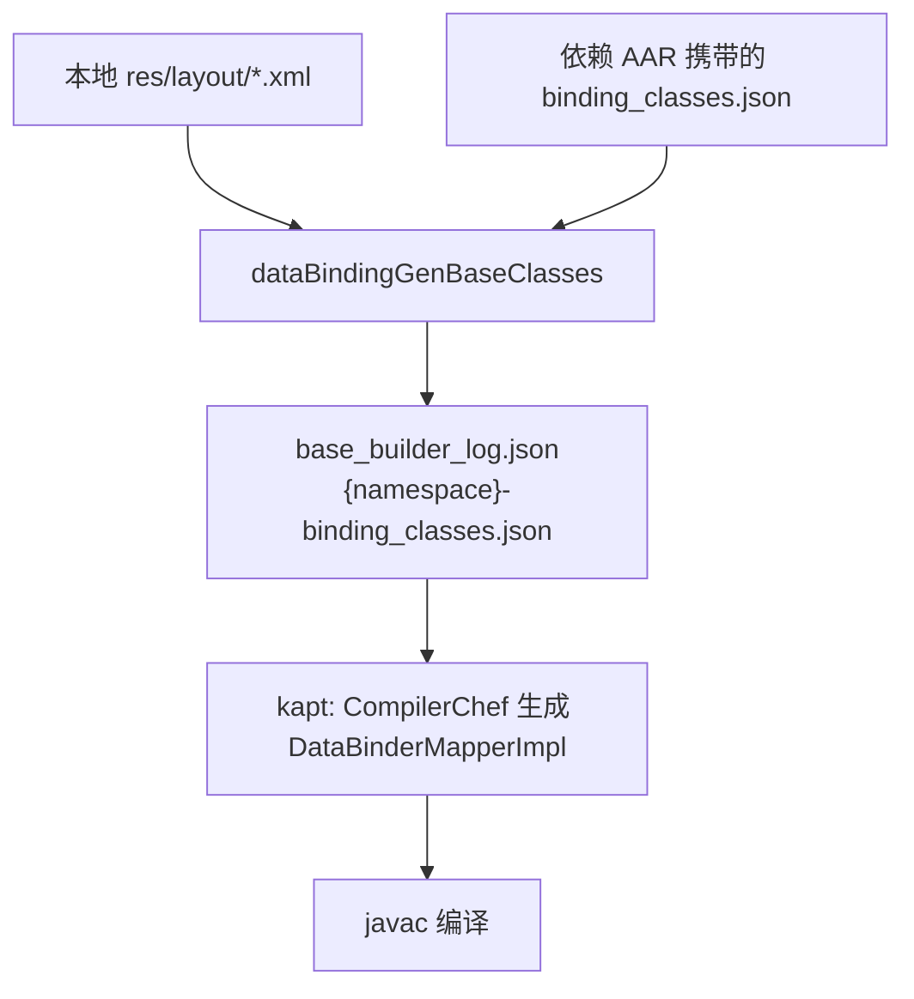

清理废弃页面时，我们删掉了十几个只被废弃代码使用的 DataBinding 布局，随后编译失败：`kapt` 生成的 `DataBinderMapperImpl` 仍然引用已删除布局的 `*BindingImpl`，javac 报十几处「找不到符号」。

`./gradlew clean`、删除 `.gradle`、停掉所有 Daemon、`--no-build-cache`、`--rerun-tasks` 都没用，每次必现。这些手段清掉的都是本地产物，所以问题的来源一定在本地之外。

**结论先行**：脏数据来自依赖的预编译 AAR。AGP 在合并 DataBinding 元数据时，会把依赖 AAR 里的历史条目原样并入当前模块。下文说明如何定位，以及如何在 Gradle 层修复。

> 文中模块名、包名、布局名均为示例，数字与日志仅用于说明现象，不是真实输出。

## 一、现象

假设基础模块 `common-ui`（namespace 为 `com.example.common`）删除了 `dialog_custom_selector.xml` 等布局。构建报错类似：

```text
> Task :common-ui:compileDebugJavaWithJavac FAILED
.../kapt/debug/com/example/common/DataBinderMapperImpl.java: 错误: 找不到符号
      case LAYOUT_DIALOGCUSTOMSELECTOR: return new DialogCustomSelectorBindingImpl(component, view);
  符号:   类 DialogCustomSelectorBindingImpl
```

布局文件已经不存在，AGP 自然不再生成 `DialogCustomSelectorBindingImpl`。但 `DataBinderMapperImpl` 仍认为本模块拥有这个布局，于是生成了对它的引用。

## 二、DataBinding 的数据流

先看 AGP 在这条链路上的处理步骤：



`DataBinderMapperImpl` 是编译的真正产物，它的内容取决于 `{namespace}-binding_classes.json`。所以我们对比两个中间文件，路径相对于模块的 `build/intermediates/`：

| 文件 | 路径 | 含义 |
| --- | --- | --- |
| `base_builder_log.json` | `incremental/dataBindingGenBaseClasses<Variant>/` | 只包含本地实际存在的布局 |
| `{namespace}-binding_classes.json` | `data_binding_base_class_log_artifact/<variant>/dataBindingGenBaseClasses<Variant>/out/` | 本模块与依赖合并后的布局清单 |

这两个文件按 UTF-16 编码，直接 `cat` 会是乱码，用 `iconv -f UTF-16 -t UTF-8` 查看。

对比结果是：前者包含 14 个布局，后者包含 17 个，多出的 3 个正是已删除的布局，并且它们的 `module_package` 都等于本模块的 namespace。`kapt` 读取的是后者，所以生成了对不存在类的引用。

问题缩小为：**这些多出来的条目是谁写进去的？**

## 三、根因：依赖 AAR 里的历史元数据

组件化工程常见「部分源码 + 部分 Maven AAR」的混合依赖。一次历史发布的过程如下：

1. 某个中间库 AAR 发布时，所依赖的 `common-ui` 还包含那些布局，AAR 里因此携带了记录它们的 `binding_classes.json`。
2. 我们在主工程里以源码方式删掉这些布局，但中间库仍以旧 AAR 的形式被依赖。
3. `DataBindingGenBaseClassesTask` 合并时，把依赖提供的 `binding_classes.json` 条目并入当前模块的输出。简化后的逻辑如下，并非 AGP 源码原文：

```java
merged.putAll(localLayouts);          // 本地布局
for (File dep : dependencyJsons) {    // 依赖 AAR 携带的元数据
    merged.putAll(parse(dep));        // 不检查布局是否仍然存在
}
```

4. 这些旧条目的 `module_package` 恰好等于本模块 namespace，`CompilerChef` 便把它们当作本模块的布局，写进 `DataBinderMapperImpl`。

这也解释了为什么 clean 无效：脏数据在 Gradle 的依赖缓存里，不在 `build/` 目录。每次构建都会重新从 AAR 中读出来。

## 四、方案对比

| 方案 | 做法 | 评价 |
| --- | --- | --- |
| 重新发布所有受影响的 AAR | 逐个升级依赖了旧布局的库并重新发版 | 根治，但要跨仓库、跨团队协作，成本高；以后每删一次布局都可能重来 |
| 不删布局 | 保留无用布局 | 回避问题，历史包袱越积越多 |
| **在 Gradle 层过滤** | 在合并之后、`kapt` 之前，剔除本模块名下已不存在的布局条目 | 无需改动上游，对开发者透明，作为过渡方案较合适 |

我们选了第三种。

## 五、实现

时机：`dataBindingGenBaseClasses<Variant>` 已写出合并结果，`kapt` 尚未开始。在这个 Task 的 `doLast` 里，按以下步骤清理：

1. 读取 `base_builder_log.json`，得到本地有效布局集合。
2. 遍历输出目录里的 `*-binding_classes.json`。
3. 删除 `module_package == 当前 namespace`，但不在有效集合内的条目。

```groovy
import groovy.json.JsonOutput
import groovy.json.JsonSlurper

private static void configureDataBinding(Project project) {
    project.tasks.matching { it.name.startsWith('dataBindingGenBaseClasses') }.configureEach { task ->
        task.doLast {
            def logFolder = task.hasProperty('logOutFolder') ? task.logOutFolder : null
            def bundleDir = task.hasProperty('classInfoBundleDir') ? task.classInfoBundleDir.asFile.orNull : null
            def pkg = task.hasProperty('namespace') ? task.namespace.orNull : null
            if (logFolder == null || bundleDir == null || pkg == null) return

            def baseLog = new File(logFolder, 'base_builder_log.json')
            if (!baseLog.exists() || !bundleDir.exists()) return

            def slurper = new JsonSlurper()
            def validLayouts = (slurper.parseText(baseLog.getText('UTF-16'))
                    ?.class_names_log?.mappings?.keySet() ?: []) as Set

            bundleDir.listFiles({ d, n -> n.endsWith('-binding_classes.json') } as FilenameFilter)?.each { file ->
                def json = slurper.parseText(file.getText('UTF-16'))
                def it = json.mappings?.entrySet()?.iterator()
                boolean changed = false
                while (it != null && it.hasNext()) {
                    def e = it.next()
                    if (e.value?.module_package == pkg && !validLayouts.contains(e.key)) {
                        project.logger.lifecycle(">>> [DataBindingFix] 移除幽灵布局: ${e.key} (${pkg})")
                        it.remove()
                        changed = true
                    }
                }
                if (changed) file.setText(JsonOutput.toJson(json), 'UTF-16')
            }
        }
    }
}
```

几个要点：

- **编码**：读写都使用 UTF-16，否则会解析失败或写坏文件。
- **只处理本模块名下的条目**：`module_package == pkg` 保证不会误删其他依赖的正常布局。
- **缓存**：该 Task 可能 `FROM-CACHE`，此时 `doLast` 不会执行，但缓存的是已清理后的输出，结果一致。
- **属性名属于 AGP 内部实现**：`logOutFolder`、`classInfoBundleDir` 等属性在不同 AGP 版本中可能变化。用 `hasProperty` 判断能避免直接崩溃，但属性改名后修复会静默失效，升级 AGP 后需要回归验证。

## 六、验证

全量构建 `assembleDebug` 与 `assembleBeta` 均通过，已删除的布局不再出现在 `DataBinderMapperImpl` 中。清理期间控制台会打印被移除的条目，便于确认钩子确实生效。

## 七、总结

1. **混合依赖会带来元数据冲突**：AAR 携带的不只是字节码和资源，还有 DataBinding 清单这类编译期元数据。源码与旧制品版本不一致时，元数据可能互相干扰。
2. **clean 无效时，先看中间产物**：`clean` 只能清除本地生成物，如果问题依旧，就应对比各 Task 的输入输出，判断脏数据的来源。本案例就是通过对比 `base_builder_log.json` 与 `binding_classes.json` 定位的。
3. **这是临时补丁，不是终点**：它绕开了 AGP 合并时不校验布局是否存在的缺陷。长期来看，仍应随着上游 AAR 的重新发布逐步淘汰这段逻辑，并在 AGP 升级时确认它是否还有必要。
